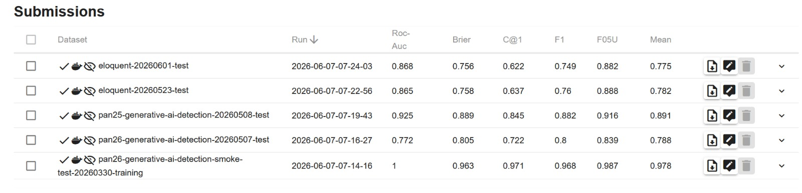
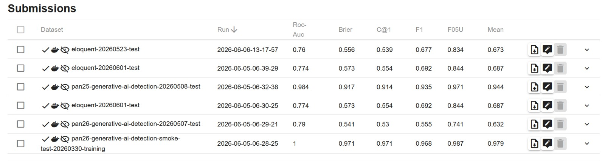
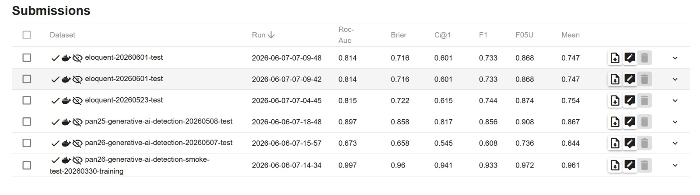
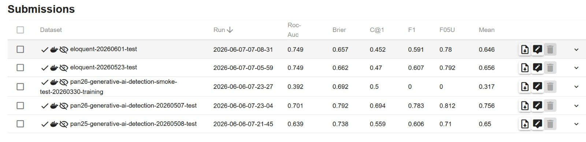

# radar
RADAR (Robust Adversarial-Resistant Detection with Adaptive Reasoning) is a hybrid architecture for detecting AI-generated text.

## Variants Submitted to TIRA

First ensure that the models are in the HF_HOME:

```
python3 -c 'from transformers import AutoTokenizer, AutoModel; AutoTokenizer.from_pretrained("MahmoodAnaam/radar-encoder-freeze", trust_remote_code=True); AutoModel.from_pretrained("MahmoodAnaam/radar-encoder-freeze", trust_remote_code=True);'
python3 -c 'from transformers import AutoTokenizer, AutoModel; AutoTokenizer.from_pretrained("MahmoodAnaam/RADAR", trust_remote_code=True); AutoModel.from_pretrained("MahmoodAnaam/RADAR", trust_remote_code=True);'
python3 -c 'from transformers import AutoTokenizer, AutoModel; AutoTokenizer.from_pretrained("MahmoodAnaam/radar-encoder-freeze-pan26", trust_remote_code=True); AutoModel.from_pretrained("MahmoodAnaam/radar-encoder-freeze-pan26", trust_remote_code=True);'
python3 -c 'from transformers import AutoTokenizer, AutoModel; AutoTokenizer.from_pretrained("MahmoodAnaam/radar-encoder-freeze-raid", trust_remote_code=True); AutoModel.from_pretrained("MahmoodAnaam/radar-encoder-freeze-raid", trust_remote_code=True);'
```

```
tira-cli code-submission \
    --dry-run \
    --path . \
    --task generative-ai-authorship-verification-panclef-2026 \
    --dataset pan26-generative-ai-detection-smoke-test-20260330-training \
    --mount-hf-model MahmoodAnaam/radar-encoder-freeze answerdotai/ModernBERT-large \
    --command '/usr/local/bin/radar --model MahmoodAnaam/radar-encoder-freeze'


tira-cli code-submission \
    --dry-run \
    --path . \
    --task generative-ai-authorship-verification-panclef-2026 \
    --dataset pan26-generative-ai-detection-smoke-test-20260330-training \
    --mount-hf-model MahmoodAnaam/radar-encoder-freeze-pan26 answerdotai/ModernBERT-large \
    --command '/usr/local/bin/radar --model MahmoodAnaam/radar-encoder-freeze-pan26'

tira-cli code-submission \
    --dry-run \
    --path . \
    --task generative-ai-authorship-verification-panclef-2026 \
    --dataset pan26-generative-ai-detection-smoke-test-20260330-training \
    --mount-hf-model MahmoodAnaam/radar-encoder-freeze-raid answerdotai/ModernBERT-large \
    --command '/usr/local/bin/radar --model MahmoodAnaam/radar-encoder-freeze-raid'


```

## Evaluation

### MahmoodAnaam/radar-encoder-freeze




### MahmoodAnaam/RADAR




### MahmoodAnaam/radar-encoder-freeze-pan26




### MahmoodAnaam/radar-encoder-freeze-raid




